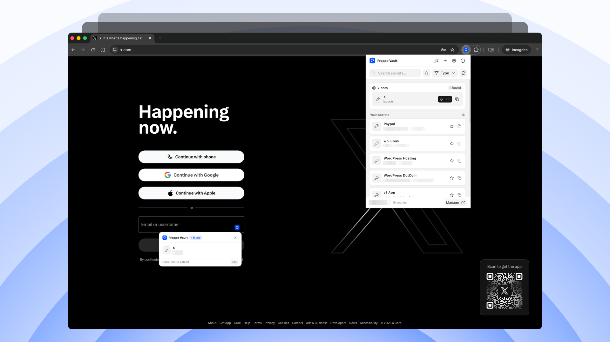

<p align="center"></p>



# Frappe Vault - Browser Extension

Browser extension for [Frappe Vault](https://github.com/lubusIN/frappe-vault). Search, autofill, and manage credentials directly from your browser.

<a href="https://chromewebstore.google.com/detail/frappe-vault/ljnpblaghkeddioeknlgcoolmomofjlj">
  
</a>

## Features

- **Domain Matching**: Detects the active tab and brings up matching credentials.
- **Autofill & Copy**: Fill login forms directly or copy usernames, passwords, and tokens.
- **Secret Management**: Search, filter by type, star favorites, and add new secrets.
- **TOTP / 2FA**: Live two-factor authentication codes with countdown timers.
- **Password Generator**: Generate strong passwords on the fly.
- **Flexible Auth**: Sign in with Frappe user credentials or API tokens.

## Prerequisites

- Node.js 20+
- npm 10+
- A running Frappe instance with [frappe_vault](https://github.com/lubusIN/frappe-vault) installed

## Setup

```bash
git clone https://github.com/lubusIN/frappe-vault-browser-extension.git
cd frappe-vault-browser-extension
npm install
```

## Development

Built with [WXT](https://wxt.dev/), Vue 3, and [frappe-ui](https://github.com/frappe/frappe-ui).

```bash
# Chrome (Manifest V3)
npm run dev

# Firefox (Manifest V2)
npm run dev:firefox
```

## Build

```bash
# Production build (outputs to .output/chrome-mv3)
npm run build

# Firefox build (outputs to .output/firefox-mv2)
npm run build:firefox

# Typecheck
npm run compile
```

## Loading the Extension

### Chrome / Chromium

1. Open `chrome://extensions`.
2. Enable **Developer mode**.
3. Click **Load unpacked** and select `.output/chrome-mv3`.

### Firefox

1. Open `about:debugging#/runtime/this-firefox`.
2. Click **Load Temporary Add-on...**.
3. Select `manifest.json` inside `.output/firefox-mv2`.

## Authentication

When opening the extension popup, enter your Frappe Vault URL (e.g., `https://vault.example.com` or `http://localhost:8000`):

- **User Login**: Standard Frappe account with `Vault User` or `Vault Admin` role.
- **API Token**: API Key and Secret generated under **User > API Access**.

## Releases

Pre-built extension packages are available under [Releases](https://github.com/lubusIN/frappe-vault-browser-extension/releases):

- **Tagged Releases**: Versioned production packages for Chrome and Firefox.
- **Dev Builds**: Bleeding-edge builds updated automatically on pushes to `main` under the [`dev` release tag](https://github.com/lubusIN/frappe-vault-browser-extension/releases/tag/dev).

For release steps, CI workflows, and Chrome Web Store setup, see [RELEASING.md](RELEASING.md).

## Support

Frappe Vault Browser Extension is a free and open-source project maintained by [LUBUS](https://lubus.in/).

For bugs, feature requests, and community support, please use GitHub [Issues](https://github.com/lubusIN/frappe-vault-browser-extension/issues). Our team reviews and addresses issues based on availability and project priorities, so we cannot guarantee response or resolution timelines for community support.

If your organization needs dedicated assistance, implementation help, customization, or priority support, get in touch with [LUBUS](https://lubus.in/contact-us).

## Contributing

Contributions are welcome! Please feel free to submit issues or Pull Request.

## More Frappe Tools

Explore more open-source tools we're building for the Frappe ecosystem.

<table>
  <tr>
    <td width="50%" valign="top">
      <a href="https://github.com/lubusIN/frappe-vault">
        
      </a>
      <br>
      Manage secrets and passwords with Frappe.
    </td>
    <td width="50%" valign="top">
      <a href="https://github.com/lubusIN/frappe-local">
        
      </a>
      <br>
      Create and manage local Frappe benches and sites visually.
    </td>
  </tr>

  <tr>
    <td width="50%" valign="top">
      <a href="https://github.com/lubusIN/frappe-playground">
        
      </a>
      <br>
      Run Frappe entirely in your browser.
    </td>
    <td width="50%" valign="top">
      <a href="https://github.com/lubusIN/wp-frappe-data-store">
        
      </a>
      <br>
      Connect WordPress and Frappe with a React data store.
    </td>
  </tr>
</table>

[Explore all LUBUS projects →](https://github.com/lubusIN)

## Meet Your Artisans

[LUBUS](https://lubus.in/?utm_source=github&utm_medium=open-source&utm_campaign=frappe-vault) is a web design agency based in Mumbai.

<a href="https://cal.com/lubus">

</a>

## License

Frappe Vault Browser Extension is open-source software licensed under the [MIT License](LICENSE).
